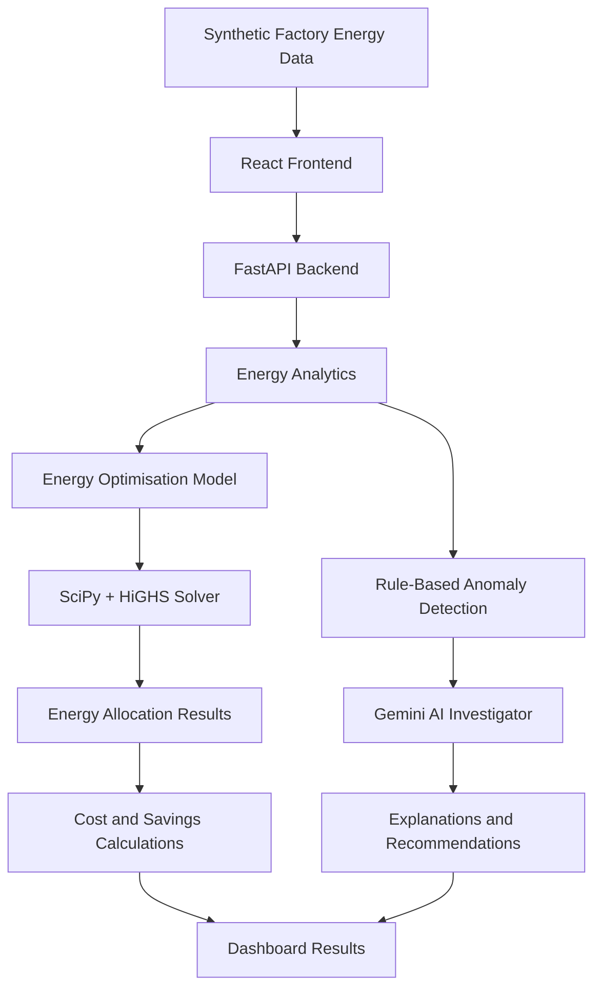

# ⚡ GridMind AI
### AI-Powered Energy Intelligence & Optimisation for MSME Factories

**Smarter energy decisions. More efficient manufacturing. A sustainable future.**

GridMind AI is an AI-powered energy optimisation prototype designed to help micro, small, and medium-sized manufacturing enterprises (MSMEs) identify unusual electricity consumption, investigate potential energy inefficiencies, and evaluate cost-effective energy allocation strategies.

The platform combines **Google Gemini for AI-assisted investigation** with **SciPy and the HiGHS optimisation solver** to analyse energy profiles, explore renewable energy utilisation, and compare baseline electricity costs with mathematically optimised scenarios.

GridMind AI aims to make energy intelligence more accessible to smaller manufacturers while supporting resource efficiency and sustainable industrial decision-making.

> **Project status:** Prototype development; cloud deployment is planned.
>
> **Data transparency:** Demonstration factories use fictional identities and synthetic data. All savings figures are modelled estimates, not verified or guaranteed real-world results.

---

## 🎯 Problem Statement

Manufacturing facilities depend on electricity for machinery, refrigeration, lighting, ventilation, and other industrial processes. Smaller manufacturers may face difficulties identifying unusual consumption, managing time-dependent electricity costs, and evaluating how available renewable energy could meet demand.

Limited visibility into energy usage can make it harder to identify potential inefficiencies and evaluate opportunities for cost reduction.

### Our Solution

GridMind AI combines energy analytics, anomaly detection, generative AI, and mathematical optimisation in a unified decision-support platform.

**Project-specific problem statement:**

> Develop an AI-powered solution to reduce electricity waste, optimise renewable energy usage, and improve energy efficiency in small and medium-sized manufacturing facilities.

The project supports the broader challenge of improving resource efficiency and enabling more informed, sustainable decision-making.

---

## ✨ Key Features

### 📊 Energy Intelligence Dashboard
- Visualise synthetic factory electricity consumption and energy profiles.
- Review factory-level energy indicators and anomaly summaries.
- Explore renewable energy availability and cost comparisons.
- Present optimisation results in an accessible interface.

### 🚨 Electricity Anomaly Detection
- Identify unusual consumption patterns using configured detection rules.
- Compare consumption against defined baselines.
- Highlight patterns that may require operational investigation.

Detected anomalies indicate potential issues; they do not independently confirm equipment faults or energy waste.

### 🤖 Gemini AI Energy Investigator
- Investigate detected anomalies using available energy evidence.
- Generate contextual explanations and possible root-cause hypotheses.
- Suggest verification steps and potential energy-efficiency improvements.
- Provide human-readable insights to support decision-making.

Google Gemini provides contextual analysis and recommendations. Its explanations are not treated as verified measurements or mathematical optimisation results.

### ⚡ Renewable Energy Optimisation
- Formulate a constrained energy-allocation problem.
- Use SciPy with the HiGHS solver to calculate numerical solutions.
- Consider configured solar, wind, biomass, and grid energy sources.
- Account for applicable generation limits, supply constraints, and cost assumptions.

### 💰 Energy Cost Analysis
- Compare baseline and optimised energy costs.
- Calculate modelled cost differences and savings percentages.
- Produce annualised projections based on assumed operating days.
- Evaluate configured time-of-use tariff scenarios.

### 🏭 Multiple Factory Profiles
Explore different synthetic industrial energy scenarios through three fictional demonstration factories.

---

## 🔄 How GridMind AI Works

1. **Select a factory:** Choose a fictional manufacturing profile.
2. **Analyse energy data:** Load the corresponding synthetic demand and energy-supply assumptions.
3. **Detect anomalies:** Evaluate consumption patterns against configured rules and baselines.
4. **Investigate findings:** Use Gemini to interpret the available evidence and propose possible explanations.
5. **Optimise energy allocation:** Solve the configured constrained optimisation model using SciPy and HiGHS.
6. **Compare costs:** Calculate baseline and optimised costs from the model inputs.
7. **Review insights:** Examine AI explanations, numerical results, and estimated savings.

The platform is designed for decision support. It does not autonomously dispatch electricity or control physical factory equipment.

---

## 🏭 Demonstration Factories

GridMind AI includes three fictional factory profiles representing different manufacturing energy scenarios.

| Factory | Demonstration ID | Industrial scenario |
|---|---|---|
| PrecisionWorks Factory | `DEMO-FAC-001` | Precision engineering, CNC machining, and off-shift consumption |
| FreshField Factory | `DEMO-FAC-002` | Food processing, cold storage, and peak demand |
| WeaveWise Factory | `DEMO-FAC-003` | Textile spinning, weaving, and shift-based energy consumption |

**Data disclosure:** These are fictional demonstration factories using synthetic data. They do not represent actual companies, customer facilities, or measured industrial energy consumption.

---

## 🏗️ System Architecture

GridMind AI separates the user interface, backend processing, AI investigation, numerical optimisation, and cost calculations.



### Architecture Overview

- **Frontend:** Presents factory profiles, energy indicators, anomaly findings, and optimisation results.
- **Backend:** Coordinates API requests, energy analysis, AI integration, and optimisation workflows.
- **AI investigation:** Uses Google Gemini to interpret available evidence and generate contextual recommendations.
- **Optimisation engine:** Uses SciPy and HiGHS to solve the configured linear programming model.
- **Cost analysis:** Calculates modelled baseline and optimised energy costs.

**Design principle:** Generative AI explains; mathematical optimisation calculates.

---

## 🛠️ Technology Stack

| Technology | Purpose |
|---|---|
| React | Frontend user interface |
| TypeScript | Frontend application logic |
| Vite | Development server and production build tooling |
| Tailwind CSS | User interface styling |
| Python | Backend processing |
| FastAPI | Backend API framework |
| Uvicorn | ASGI application server |
| Google Gemini | AI-assisted energy investigation |
| `google-genai` | Google GenAI SDK |
| SciPy | Scientific computing and optimisation interface |
| HiGHS | Linear programming solver |
| Google Cloud Run | Planned backend hosting |
| Firebase Hosting | Planned frontend hosting |

The technology list should reflect the dependencies and configuration present in the project repository.

---

## 🧮 Energy Optimisation Model

GridMind AI uses mathematical optimisation to evaluate how configured energy sources can meet modelled electricity demand at a lower cost.

A simplified representation of the objective is:

\[
\min \sum_{t=1}^{T}\sum_{s\in S} c_{s,t}x_{s,t}
\]

Where:

- \(t\) represents a time interval.
- \(S\) represents the available energy sources.
- \(c_{s,t}\) represents the configured unit cost of source \(s\) during interval \(t\).
- \(x_{s,t}\) represents the energy allocated from source \(s\) during interval \(t\).

The implemented model may include demand-supply balance, generation availability, equipment capacities, grid limits, and other configured constraints.

### Energy Sources

- **Solar energy:** Modelled according to the configured generation profile.
- **Wind energy:** Modelled according to the configured generation profile.
- **Biomass energy:** Includes configured fuel costs where represented in the model.
- **Grid electricity:** Priced using the configured tariff assumptions.

Renewable energy may have a zero marginal operating cost in the model. This does not imply that renewable infrastructure, maintenance, storage, or other associated expenses are free.

### Illustrative Time-of-Use Tariffs

| Period | Illustrative time window | Rate |
|---|---|---:|
| Off-peak | 10 PM–6 AM | ₹6.50/kWh |
| Normal | 6 AM–6 PM | ₹8.20/kWh |
| Peak | 6 PM–10 PM | ₹11.80/kWh |

These are illustrative demonstration rates, not verified tariffs from an electricity provider. Their use in the README should match the current application configuration.

### Savings Calculations

**Estimated daily savings**

\[
S_{\text{daily}}=C_{\text{baseline}}-C_{\text{optimised}}
\]

**Estimated savings percentage**

\[
S_{\%}=
\frac{C_{\text{baseline}}-C_{\text{optimised}}}
{C_{\text{baseline}}}\times100
\]

**Modelled annual savings**

\[
S_{\text{annual}}=S_{\text{daily}}\times D
\]

Here, \(D\) represents the assumed number of operating days per year.

These calculations estimate potential savings under the model's assumptions. Actual outcomes depend on real demand, tariffs, production schedules, equipment constraints, renewable availability, and other operating costs.

---

## 📂 Project Structure

The project is organised around a frontend application and a backend service. The following illustrates the intended high-level structure; actual paths should match the repository.

```text
Grid-Mind-AI/
├── backend/
│   ├── app/
│   ├── tests/
│   ├── requirements.txt
│   └── .env.example
├── frontend/
│   ├── src/
│   ├── package.json
│   └── ...
└── README.md
```

The backend handles API requests, AI integration, anomaly analysis, and optimisation. The frontend provides the user interface and presents results.

---

## 🚀 Getting Started

### Prerequisites

- Python compatible with the backend dependencies.
- Node.js and npm compatible with the frontend.
- Git, if cloning the repository.
- A Google Gemini API key for AI-investigation functionality.

### Clone the Repository

```bash
git clone https://github.com/Sai-Harshith-01/Grid-Mind-AI.git
cd Grid-Mind-AI
```

### Run the Backend

From the project root, enter the backend directory:

```powershell
cd backend
python -m venv .venv
.\.venv\Scripts\Activate.ps1
python -m pip install --upgrade pip
pip install -r requirements.txt
```

If the repository contains an `.env.example` file, create a local environment file:

```powershell
Copy-Item .env.example .env
```

Configure the required environment variables using the names defined in the project. Store the Gemini API key securely on the backend.

If the application entry point is `app.main`, start the server with:

```powershell
uvicorn app.main:app --reload --port 8000
```

### Run the Frontend

Open a second terminal:

```powershell
cd frontend
npm install
npm run dev
```

Open the local development URL printed by Vite. Configure the frontend API base URL according to the environment-variable names used by the application.

### API Documentation

If the backend uses FastAPI's default documentation settings, interactive API documentation is available at:

`http://localhost:8000/docs`

The OpenAPI schema may be available at:

`http://localhost:8000/openapi.json`

The actual URLs depend on the application's host, port, and documentation configuration.

---

## 🧪 Testing and Validation

Backend tests can be run with pytest if the repository includes the corresponding test setup:

```bash
python -m pytest tests/ -v
```

Run the command from the backend directory.

Build the frontend for production from the frontend directory:

```bash
npm run build
```

Testing should cover anomaly detection, optimisation constraints, cost calculations, API responses, error handling, and frontend behaviour.

Test counts and successful results should only be reported after they have been verified in the current environment.

---

## ☁️ Cloud Deployment

GridMind AI is being prepared for deployment using Google Cloud services.

The intended deployment architecture is:

| Component | Target service | Purpose |
|---|---|---|
| Backend | Google Cloud Run | Host the FastAPI application |
| Frontend | Firebase Hosting | Serve the production web application |
| AI credentials | Server-side secret configuration | Protect the Gemini API key |

The deployment process includes configuring the production backend, securely providing the Gemini API key, setting the frontend's production API URL, configuring CORS, and validating the application end to end.

**Deployment status:** Planned / in progress. Public URLs will be published here after the deployed services have been verified.

Cloud resource usage may incur charges depending on configuration and consumption. Review current pricing and billing requirements before deployment.

---

## 🔐 Security and Privacy

GridMind AI follows these security principles:

- Keep API keys and credentials on the backend.
- Never embed private keys in frontend source code.
- Exclude `.env` files and secrets from version control.
- Use secure server-side configuration for deployed environments.
- Restrict production CORS to approved frontend origins.
- Validate incoming API requests.
- Avoid logging sensitive credentials.
- Review authentication, access controls, and rate limiting before production use.

The current demonstration uses synthetic factory data. Integrating real industrial data would require additional privacy, security, and access-control considerations.

---

## 🌱 Sustainability Impact

GridMind AI explores how AI-assisted analysis and mathematical optimisation may support more efficient industrial energy management.

### Potential Benefits

**Reduced electricity waste:** Anomaly detection can highlight consumption patterns that deserve further investigation.

**Improved cost awareness:** Tariff-based comparisons help users explore how energy allocation affects modelled electricity costs.

**Renewable energy utilisation:** The optimiser evaluates the contribution of available renewable generation within its configured constraints.

**Accessible energy intelligence:** An integrated dashboard can make energy analysis easier to explore for smaller manufacturers.

**Informed sustainability decisions:** Modelled scenarios can help identify opportunities worth validating before real operational changes are considered.

These benefits are intended outcomes. Real electricity reductions, financial savings, and emissions improvements must be established through real-world measurement and validation.

---

## ⚠️ Limitations

GridMind AI is a prototype with the following limitations:

- Demonstration factories and energy profiles are synthetic.
- Tariff values are illustrative and may not match actual utility rates.
- Optimisation results depend on the implemented objective, constraints, and input assumptions.
- Capital costs, maintenance, storage, and other expenses may not be fully represented.
- Gemini-generated explanations can be incorrect and require verification.
- The application does not autonomously control physical factory equipment.
- Savings figures are modelled estimates, not guaranteed outcomes.
- Cloud deployment remains unverified until the public application has been tested.

The platform is a decision-support prototype, not a certified energy audit or a substitute for professional engineering review.

---

## 🛣️ Future Development

Future development may include:

- Cloud deployment and production environment validation.
- Integration with authorised factory meter data.
- Validation against real electricity tariffs and production schedules.
- More detailed equipment and operational constraints.
- Historical energy analytics and trend monitoring.
- Improved evaluation of anomaly detection and optimisation quality.
- Pilot studies with participating MSME manufacturers.
- Measurement of actual energy, cost, and environmental outcomes.

These are future development directions rather than claims of currently available functionality.

---

## 👥 Team

**Team Name:** Techies  
**Team Leader:** Sai Harshith  
**Project:** GridMind AI  
**Focus:** Sustainable energy, industrial efficiency, AI-assisted investigation, and mathematical optimisation.

---

## 📄 License

No open-source license is currently specified. Unless a license is added to the repository, permissions to use, modify, or redistribute the project should not be assumed.

---

## ⚡ Smarter Energy Decisions. More Efficient Industry.

GridMind AI brings together generative AI and mathematical optimisation to explore how manufacturing facilities can better understand energy usage and evaluate potential efficiency improvements.

By combining explainable investigation with numerical optimisation, the project aims to turn energy data into actionable insights and support a more sustainable approach to industrial operations.

**Built to explore a smarter, more energy-efficient future for manufacturing.** 🌱
