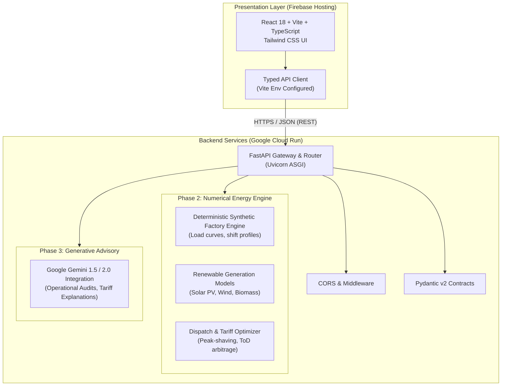

# GridMind AI — System Architecture Specification

## 1. Executive Summary & Purpose

**GridMind AI** is an AI-powered renewable energy intelligence and optimisation platform tailored specifically for **MSME (Micro, Small, and Medium Enterprises) factories**. 

MSMEs face unique energy challenges:
- High grid electricity tariff volatility, peak demand penalties, and Time-of-Day (ToD) surcharges.
- Sub-optimal utilization of captive renewable assets (rooftop Solar PV, captive Wind Turbines, and agro-waste Biomass boilers).
- Lack of dedicated in-house energy engineers or capital for heavy industrial Energy Management Systems (EMS).

GridMind AI bridges this gap with a modern, lightweight, and cloud-native architecture combining deterministic numerical optimization with Google Gemini generative intelligence.

---

## 2. System Architecture Overview

---

## 3. Subsystem Responsibilities

### 3.1. Frontend Layer (`frontend/`)
- **Technology**: React 18, Vite, TypeScript, Tailwind CSS, Lucide Icons.
- **Responsibilities**:
  - Delivers a responsive, accessible dashboard for factory energy managers.
  - Interacts with backend services exclusively through a strongly typed API utility layer (`src/api/`).
  - Implements proactive error boundaries, connection retry states, and visual system diagnostics.
  - Displays real-time operational status, dispatch schedules, and tariff advisory reports.
- **Hosting Target**: Firebase Hosting (fast global CDN, HTTPS by default, atomic rollbacks).

### 3.2. FastAPI Backend Layer (`backend/`)
- **Technology**: Python 3.11+, FastAPI, Uvicorn, Pydantic v2.
- **Responsibilities**:
  - Serves as the central API gateway and orchestration layer.
  - Enforces strict input validation and serialization via Pydantic schemas.
  - Manages CORS origins dynamically based on runtime environment configuration.
  - Provides endpoints for health monitoring, factory simulation triggering, optimization runs, and LLM queries.
- **Hosting Target**: Google Cloud Run (fully managed, auto-scaling, containerized execution).

### 3.3. Numerical Energy Engine (Future Phase)
- **Technology**: NumPy, SciPy / PuLP, Pandas.
- **Responsibilities**:
  - **Synthetic Factory Modeling**: Deterministically generates realistic 15-minute interval industrial load profiles (e.g., CNC milling, injection moulding, furnace cycles, cold storage).
  - **Renewable Asset Modeling**:
    - **Solar PV**: Simulates irradiance curves, temperature degradation, and cloud cover dips.
    - **Wind Generation**: Simulates cut-in/rated/cut-out wind speeds and turbine power curves.
    - **Biomass Cogeneration**: Models boiler fuel consumption (briquettes/bagasse), thermal heat, and baseline electric output.
  - **Dispatch Optimization**: Solves constrained optimization for cost minimization under multi-tier Time-of-Day (ToD) tariffs and maximum contracted demand limits.

### 3.4. Generative AI Service — Google Gemini (Future Phase)
- **Technology**: Google GenAI SDK (`google-generativeai`).
- **Responsibilities**:
  - Converts complex numerical optimization matrices into plain-language actionable recommendations for plant managers.
  - Identifies and explains peak demand anomalies and penalty risks.
  - Generates weekly executive summaries and carbon abatement audit logs.
  - Enforces prompt guardrails and deterministic data grounding (no hallucinations of numeric tariff numbers).

### 3.5. Deployment & Infrastructure Layer
- **Containerization**: Multi-stage Dockerfile for FastAPI, production static build for Vite.
- **Cloud Run**: Serverless container execution with environment-variable-driven secret injection (Google Cloud Secret Manager).
- **Firebase Hosting**: Serves the pre-compiled SPA assets, rewriting routes to `index.html` with optional Cloud Run proxy rewrites (`/api/**`).

---

## 4. API Communication Contracts (Phase 1 Baseline)

| Endpoint | Method | Response Schema | Description |
| :--- | :--- | :--- | :--- |
| `/` | `GET` | `AppInfoResponse` | Service metadata, application name, description, and docs pointer |
| `/health` | `GET` | `HealthResponse` | Operational status, service identifier, semantic version, UTC timestamp |
| `/docs` | `GET` | OpenAPI UI | Interactive Swagger documentation for API consumers |

---

## 5. Security & Configuration Best Practices

- **Zero Hardcoded Secrets**: Secrets and external API keys (such as `GEMINI_API_KEY`) are managed exclusively via environment variables and Cloud Secret Manager.
- **Strict CORS Origin Filtering**: Cross-Origin requests are constrained to explicitly listed frontend URLs.
- **Separation of Concerns**: Numerical computation, business logic, and presentation logic are isolated into modular packages.

---

## 6. Implementation Phasing Roadmap

1. **Phase 1 (Current)**: Project Foundation — Directory structure, React + Vite + TS + Tailwind frontend, FastAPI backend, health check integration, typed client, and documentation.
2. **Phase 2**: Deterministic Factory Engine & Energy Simulators — 15-minute interval synthetic load curves, Solar/Wind/Biomass models, and multi-tariff calculation.
3. **Phase 3**: Optimization Engine — Mathematical solver for economic dispatch and peak shaving.
4. **Phase 4**: Google Gemini Integration — Contextual advisory, anomaly insights, and executive summaries.
5. **Phase 5**: Cloud Deployment — Google Cloud Run containerization and Firebase Hosting pipeline setup.
