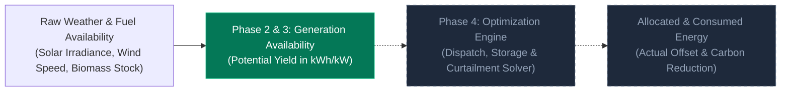

# GridMind AI — Phase 3 Energy Analysis Specification

## 1. Executive Summary & Purpose

This document provides technical documentation for the **Phase 3 Energy Analytics & Anomaly Detection Service**. 
It details:
- Mathematical formulations for all energy, production, and cost metrics.
- The reference Time-of-Day (ToD) grid-only cost baseline.
- Renewable energy availability versus actual allocation and consumption semantics.
- Rule-based, explainable anomaly detection algorithms, thresholds, and severity ratings.
- JSON response schema definitions and endpoint contracts.

> [!IMPORTANT]
> **SIMULATION NOTICE**  
> All calculations operate upon the deterministic synthetic factory model established in Phase 2. All metrics, estimated monetary impacts, and detected anomaly patterns are algorithmic diagnostic simulations and must not be treated as empirical measurements from physical factory hardware.

---

## 2. Core Mathematical Formulations

### 2.1. Factory Demand & Intensity Metrics

Let $N = 24$ be the number of hourly intervals in the daily evaluation window ($h \in \{0, 1, \dots, 23\}$).  
Let $E_h$ be the total factory energy demand in kilowatt-hours (kWh) for interval $h$.  
Let $P_h$ be the instantaneous factory electric demand in kilowatts (kW) for interval $h$.  
Let $Y_h$ be the simulated actual production output in finished components for interval $h$.  
Let $\Delta t_h = 1.0\text{ h}$ be the explicit interval duration.

#### Total Factory Demand ($E_{\text{total}}$)
$$E_{\text{total}} = \sum_{h=0}^{N-1} E_h \quad [\text{kWh}]$$

#### Average Hourly Demand ($\bar{E}$)
$$\bar{E} = \frac{E_{\text{total}}}{N} \quad [\text{kWh/interval}]$$

#### Average Instantaneous Power ($\bar{P}$)
$$\bar{P} = \frac{E_{\text{total}}}{\sum_{h=0}^{N-1} \Delta t_h} = \frac{E_{\text{total}}}{24} \quad [\text{kW}]$$

#### Peak Instantaneous Demand ($P_{\text{peak}}$)
$$P_{\text{peak}} = \max_{h} (P_h) \quad [\text{kW}]$$

#### Overall Factory Energy Intensity ($I$)
$$I = \begin{cases} 
\dfrac{E_{\text{total}}}{\sum_{h=0}^{N-1} Y_h} & \text{if } \sum_{h=0}^{N-1} Y_h > 0 \quad [\text{kWh/unit}] \\
\text{null} & \text{if } \sum_{h=0}^{N-1} Y_h = 0 
\end{cases}$$
*Division-by-zero protection is strictly enforced: when production throughput is zero (e.g. during maintenance shifts), intensity returns `null` rather than generating numerical errors or infinite values.*

---

### 2.2. Zone & Shift Breakdown Metrics

#### Zone Consumption Share
For each production zone $z \in \{\text{zone\_cnc}, \text{zone\_heat\_treatment}, \text{zone\_finishing\_packaging}\}$:
$$\text{Share}_z = \frac{\sum_{h=0}^{N-1} E_{z, h}}{E_{\text{total}}} \times 100\%$$

#### Zone Energy Intensity
$$I_z = \begin{cases} 
\dfrac{\sum_{h=0}^{N-1} E_{z, h}}{\sum_{h=0}^{N-1} Y_{z, h}} & \text{if } \sum_{h=0}^{N-1} Y_{z, h} > 0 \\
\text{null} & \text{if } \sum_{h=0}^{N-1} Y_{z, h} = 0
\end{cases}$$

#### Shift-Level Aggregation
For each operational shift $S \in \{\text{Shift 1: Morning}, \text{Shift 2: Evening}, \text{Shift 3: Night}\}$:
$$E_S = \sum_{h \in S} E_h, \quad \bar{P}_S = \frac{E_S}{|S|}, \quad Y_S = \sum_{h \in S} Y_h$$

---

## 3. Renewable Availability vs. Energy Allocation

A critical conceptual distinction in GridMind AI is the separation of **source availability** from **energy allocation**:

- **Available Renewable Energy ($E_{\text{avail}, s}$)**: The maximum physical energy that *could* be harvested from generation asset $s$ under current ambient weather or fuel conditions.
- **Renewable Availability Ratio**:
  $$\text{Ratio}_{\text{avail}} = \frac{\sum_{s} E_{\text{avail}, s}}{E_{\text{total}}} \times 100\%$$
- *This is an index of self-generation potential, NOT an actual renewable penetration rate. Actual self-consumption requires dispatch matching, battery storage, and grid-export policy constraints, which are addressed in subsequent optimization phases.*

### Capacity Factor ($CF_s$)
For each generation source $s$ with rated nameplate capacity $C_s$ [kW]:
$$CF_s = \frac{E_{\text{avail}, s}}{C_s \times 24\text{ h}} \times 100\%$$

---

## 4. Grid-Only Cost Baseline

The **Grid-Only Cost Baseline** calculates the reference economic expenditure assuming the factory had zero on-site renewable generation and was forced to procure 100% of its electricity demand from the utility grid under the local Time-of-Day (ToD) tariff structure.

Let $T_h$ be the prevailing tariff rate in INR/kWh for hour $h$:
$$\text{Cost}_{\text{baseline}} = \sum_{h=0}^{N-1} \left( E_h \times T_h \right) \quad [\text{INR / ₹}]$$

### Blended Electricity Rate
$$\bar{T}_{\text{blended}} = \frac{\text{Cost}_{\text{baseline}}}{E_{\text{total}}} \quad [\text{₹/kWh}]$$

### Tariff Structure (Regional Commercial/Industrial HT Schedule)
| Tariff Period | Hours Covered | Rate (₹/kWh) | Purpose |
| :--- | :--- | :--- | :--- |
| **Off-Peak / Night** | 22:00 – 06:00 (8h) | ₹6.50 | Base night incentive rate |
| **Normal / Day** | 06:00 – 18:00 (12h) | ₹8.20 | Standard industrial operating tariff |
| **Peak Evening Surcharge** | 18:00 – 22:00 (4h) | ₹11.80 | High-demand peak surcharge (+₹3.60/kWh) |

### Capacity Constraint Check
Let $C_{\text{grid}} = 250.0\text{ kW}$ be the sanctioned contract demand.
$$\text{Headroom} = C_{\text{grid}} - P_{\text{peak}} \quad [\text{kW}]$$
$$\text{Exceeds Capacity} = \begin{cases} \text{true} & \text{if } P_{\text{peak}} > C_{\text{grid}} \\ \text{false} & \text{if } P_{\text{peak}} \le C_{\text{grid}} \end{cases}$$

---

## 5. Anomaly Detection Heuristics & Rules

The anomaly detection service implements three deterministic, explainable industrial engineering rules:

### 5.1. Rule 1: Idle-Machine Energy Waste (`RULE_IDLE_WASTE_01`)
- **Objective**: Detect equipment consuming active heating or motor power when its production zone is scheduled off.
- **Trigger Condition**:  
  $$\text{Zone Scheduled Active} = \text{False} \quad \text{AND} \quad P_{\text{zone}, h} > 1.20 \times P_{\text{zone, idle\_baseline}}$$
- **Deviation Calculation**:
  $$\Delta P = P_{\text{zone}, h} - P_{\text{zone, idle\_baseline}} \quad [\text{kW}]$$
  $$\Delta \% = \frac{\Delta P}{P_{\text{zone, idle\_baseline}}} \times 100\%$$
- **Severity Rating**: `medium` (avoidable financial waste, no immediate mechanical damage).
- **Financial Impact Calculation**:
  $$\text{Impact} = \Delta P \times 1.0\text{ h} \times T_h \quad [\text{INR}]$$

### 5.2. Rule 2: Unexpected Consumption Spike (`RULE_CONSUMPTION_SPIKE_02`)
- **Objective**: Detect active production zones operating significantly above their calibrated active baseline power.
- **Trigger Condition**:  
  $$\text{Zone Scheduled Active} = \text{True} \quad \text{AND} \quad P_{\text{zone}, h} > 1.35 \times P_{\text{zone, active\_baseline}}$$
- **Deviation Calculation**:
  $$\Delta P = P_{\text{zone}, h} - P_{\text{zone, active\_baseline}} \quad [\text{kW}]$$
  $$\Delta \% = \frac{\Delta P}{P_{\text{zone, active\_baseline}}} \times 100\%$$
- **Severity Rating**: `high` (indicates pneumatic ring-main rupture, tool binding, or severe motor overload).

### 5.3. Rule 3: High-Demand Grid Capacity Risk (`RULE_PEAK_CAPACITY_RISK_03`)
- **Objective**: Alert when aggregate factory demand approaches or breaches sanctioned contract demand.
- **Trigger Condition**:  
  $$P_h \ge 0.88 \times C_{\text{grid}} \quad (220.0\text{ kW})$$
- **Severity Rating Assignment**:
  $$\text{Severity} = \begin{cases} 
  \text{critical} & \text{if } P_h \ge 0.95 \times C_{\text{grid}} \quad (237.5\text{ kW}) \\
  \text{high} & \text{if } 0.88 \times C_{\text{grid}} \le P_h < 0.95 \times C_{\text{grid}}
  \end{cases}$$
- **Physical Context**: High risk of utility maximum-demand penalties, supply trip, and heightened cost during peak tariff hours.

---

## 6. Phase 3 API Endpoints

| Method | Endpoint | Query Filters | Response Model | Description |
| :--- | :--- | :--- | :--- | :--- |
| `GET` | `/api/analysis/metrics` | None | `EnergyMetricsSummaryResponse` | Full factory metrics, zone/shift breakdowns, renewables availability, cost baseline |
| `GET` | `/api/analysis/anomalies` | `severity`, `category`, `zone_id` | `AnomalyListResponse` | List of rule-detected anomaly findings with severity breakdowns |
| `GET` | `/api/analysis/anomalies/{id}` | Path parameter | `DetectedAnomalyFinding` | Detailed single anomaly evidence, diagnostic rule description, and financial impact |
| `GET` | `/api/analysis/energy-profile` | None | `AnalyticalEnergyProfileResponse` | 24-hour analytical time series with hourly costs and renewable yields |
