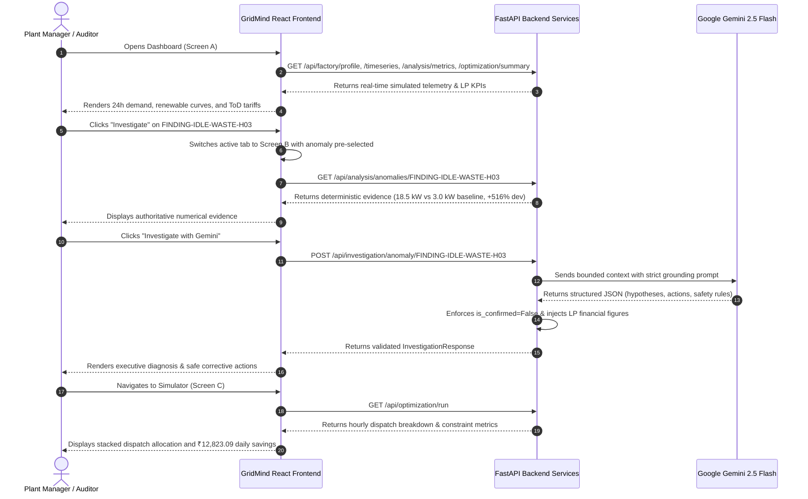

# Phase 6: Frontend Energy Intelligence Dashboard

This document details the frontend architecture, component hierarchy, design system, real-time API integrations, and demo walkthrough for the GridMind AI user interface.

---

## 1. Frontend Architecture & Technology Stack

- **Framework**: React 18 (TypeScript 5.6)
- **Build Tool**: Vite 5.4 with HMR and production chunk minification
- **Styling**: Tailwind CSS 3.4 with custom industrial palette (slate-50 workspace, slate-900 navigation, teal/emerald renewable accents, amber warnings, rose alerts)
- **Data Visualization**: Recharts (responsive ComposedChart, AreaChart, BarChart, and LineChart)
- **Icons**: Lucide React
- **API Client**: Centralized typed HTTP fetch client with environment configuration (`VITE_API_BASE_URL`)

```text
frontend/src/
├── api/
│   ├── client.ts             # Typed fetch wrappers (getJson, postJson) with FastAPI error extraction
│   ├── health.ts             # Health check endpoints
│   └── index.ts              # Exported API methods across Phases 1–5
├── types/
│   ├── api.ts                # TypeScript interfaces mirroring all backend Pydantic models
│   └── index.ts              # Type re-exports
├── utils/
│   └── formatters.ts         # INR currency, kW, kWh, percentages, and timestamp formatters
├── components/
│   ├── layout/
│   │   ├── Sidebar.tsx       # Industrial navigation, factory profile card, simulation tag, health indicator
│   │   └── Header.tsx        # Dynamic title, subtitle, refresh button, time horizon badge
│   ├── ui/
│   │   └── KpiCard.tsx       # Reusable industrial metric card with estimate tags and theme accents
│   ├── charts/
│   │   ├── DemandTariffChart.tsx          # Dual-axis: Demand (kW) & ToD Tariffs (₹/kWh)
│   │   ├── ZoneDemandChart.tsx            # Stacked area: CNC, Heat Treatment, and Assembly
│   │   ├── RenewableAvailabilityChart.tsx # Generation potential: Solar, Wind, and Biomass
│   │   ├── OptimizedDispatchChart.tsx     # Stacked bar: HiGHS LP multi-source dispatch
│   │   └── HourlyCostComparisonChart.tsx  # Cost curves: 100% Grid Baseline vs Optimised
│   └── dashboard/
│       └── AnomalyAlertsSection.tsx       # Prioritised anomaly table with direct "Investigate" action
├── pages/
│   ├── DashboardPage.tsx     # Screen A: Main operations overview & telemetry
│   ├── InvestigatorPage.tsx  # Screen B: Gemini AI Energy Waste Investigator & report modal
│   └── OptimizationPage.tsx  # Screen C: Renewable Dispatch Simulator & constraint monitoring
├── App.tsx                   # Central shell coordinating shared state & navigation
├── main.tsx                  # Application mount
└── index.css                 # Tailwind directives, animations, and custom scrollbars
```

---

## 2. Screen Specifications

### Screen A: Factory Energy Dashboard (`DashboardPage.tsx`)
1. **Facility Context & Simulation Warning**:
   - Header displays factory name (*PrecisionWorks Factory*), location (*Peenya Industrial Area, Bengaluru*), and sanctioned grid capacity (250 kW).
   - Prominent amber banner highlights that all readings and power curves are simulated for an MSME manufacturing prototype (fixed seed #42).
2. **Key Performance Indicators (KPIs)**:
   - Total factory demand (2,684.5 kWh).
   - Peak instantaneous power (238.5 kW).
   - Energy intensity (2.44 kWh/unit across 1,100 finished automotive components).
   - Renewable availability (2,492.3 kWh potential) vs LP allocated renewables (1,478.0 kWh).
   - Estimated 100% grid baseline reference spend (₹22,458.95).
   - Optimised scenario supply spend (₹9,635.86).
   - Estimated daily economic savings (₹12,823.09 / 57.1% reduction).
3. **Interactive Industrial Visualizations**:
   - **Demand vs ToD Tariffs**: Dual-axis bar and line chart illustrating factory load curves against off-peak (₹6.50), normal (₹8.20), and peak surcharge (₹11.80) windows.
   - **Zone Consumption**: Stacked area chart showing relative consumption of CNC & Machining, Heat Treatment & Induction, and Assembly & Finishing.
   - **Renewable Availability**: Potential generation availability curves for on-site Solar PV (100 kWp), Wind (60 kW), and Biomass (50 kW capacity).
   - **Hourly Cost Comparison**: Baseline reference vs optimised cost over time.
4. **Prioritised Operational Anomalies**:
   - Interactive table ranking rule-based findings by severity (Critical > High > Medium > Low).
   - Shows observed reading, expected baseline, calculated deviation %, and timestamp.
   - Direct action button: **"Investigate"** — immediately switches navigation to Screen B with that finding pre-selected.

---

### Screen B: AI Energy Investigator (`InvestigatorPage.tsx`)
1. **Gemini AI Readiness Status**:
   - Fetches `GET /api/investigation/status` and displays service readiness without exposing keys.
   - If `GEMINI_API_KEY` is not present, clearly explains that the rule-based evidence is fully functional while generative features require setting the key.
2. **Filterable Finding Selector**:
   - Quick filters by severity (All, Critical, High, Medium, Low) and category (Idle Waste, Spike, Peak Risk).
3. **Authoritative Evidence Panel**:
   - Observed value and unit, expected threshold, calculated deviation %, ToD tariff at interval.
   - Deterministic detection rule identifier and explanation.
   - Engineering physical diagnostic hypothesis from Phase 3 detector.
4. **Gemini Investigation Trigger**:
   - **"Investigate with Gemini"** button calls `POST /api/investigation/anomaly/{id}`.
   - Displays loading spinner and disables duplicate submissions.
   - Presents Gemini's executive summary and bulleted factual observations.
   - Clearly labels possible physical causes as **Unconfirmed Hypotheses** (`is_confirmed: false`) with likelihood and supporting data.
   - Renders prioritised recommendations with:
     - Priority badge (Critical, High, Medium, Low)
     - Action and engineering rationale
     - Expected operational benefit
     - Safety considerations (PPE, Lockout/Tagout, rating limits)
     - Concrete verification step
   - Displays authoritative backend financial summary (excess energy kWh, interval tariff cost, daily plant spend, scenario savings).
5. **Executive Audit Report Modal**:
   - Button: **"Generate Executive Report"** triggers `POST /api/investigation/report`.
   - Synthesizes plant-wide energy waste patterns, peak tariff risks, and prioritized actions across the facility.
   - Includes a print button triggering `window.print()` for clean documentation export.

---

### Screen C: Renewable Optimisation Simulator (`OptimizationPage.tsx`)
1. **Scenario Summary & Solver Feasibility**:
   - Displays termination status from the SciPy HiGHS linear programming engine (`Optimal`, 0 infeasible intervals).
   - Highlights total demand served (2,684.5 kWh) and renewable allocation percentage (55.1%).
2. **KPIs**:
   - Baseline Cost: ₹22,458.95
   - Optimised Supply Cost: ₹9,635.86
   - Estimated Daily Savings: ₹12,823.09 (57.1% cost cut)
   - Peak Grid Demand: 188.5 kW (75.4% contract capacity utilisation)
3. **Hourly Multi-Source Dispatch Chart**:
   - Stacked bar chart showing the exact allocation of Solar, Wind, Biomass, and Grid import satisfying factory demand at each hour.
4. **Operational Constraints & Utilization**:
   - **Grid Sanctioned Capacity**: 250 kW contract demand, 188.5 kW peak import, 61.5 kW safety headroom.
   - **Biomass Gasifier Fuel**: 312.5 kWh generated, 250.0 kg briquette stock consumed, 0.0 kg remaining (fully dispatched during peak ₹11.80/kWh hours).
   - **Merit-Order Rules**: Explains the economic hierarchy ($0 solar/wind $\to$ ₹4.20 biomass $\to$ ₹6.50–₹11.80 grid).
5. **Re-Run LP Dispatch**:
   - Functional button re-executes optimization via the backend and updates the UI live.

---

## 3. End-to-End Demo Flow



---

## 4. Running the Complete Application Locally

### Step 1: Start Backend (Terminal 1)
```powershell
cd e:\Grid-Mind\backend
.\.venv\Scripts\Activate.ps1
uvicorn app.main:app --reload --port 8000
```
Backend will be available at [http://localhost:8000](http://localhost:8000).

### Step 2: Start Frontend (Terminal 2)
```powershell
cd e:\Grid-Mind\frontend
npm run dev
```
Open your browser at [http://localhost:5173](http://localhost:5173).

---

## 5. Verification Commands

### Run Backend Automated Tests:
```powershell
cd e:\Grid-Mind\backend
.\.venv\Scripts\pytest -v
```
*Result: 71 passed in ~8.5 seconds.*

### Run Frontend Production Build:
```powershell
cd e:\Grid-Mind\frontend
npm run build
```
*Result: TypeScript compilation and Vite minification succeed cleanly in ~24 seconds.*
