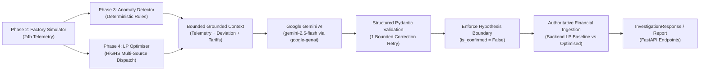

# Phase 5: Gemini AI Energy Waste Investigator

This document describes the design, configuration, prompt engineering, structured schemas, resilience mechanisms, and security architecture of the Gemini AI investigation service in GridMind AI.

---

## 1. Architectural Role & Workflow

The core operational pipeline of GridMind AI follows the paradigm:

$$\text{Detect} \longrightarrow \text{Investigate with Gemini} \longrightarrow \text{Optimise} \longrightarrow \text{Measure Impact}$$



### Core Design Rules
1. **The LLM never calculates financial totals, tariffs, or physical telemetry.** All numerical figures (excess kWh, interval cost, baseline vs optimized spend, and potential savings) are computed strictly by the deterministic Python backend (`EnergyMetricsService`, `AnomalyDetectorService`, and `EnergyOptimizerService`).
2. **Strict Evidence Boundary:** All data fields (machine names, factory descriptions, telemetry readings) are treated as inert untrusted evidence. Prompt injection attempts embedded within data fields cannot alter investigation instructions.
3. **Hypothesis vs Confirmed Reality:** Any physical cause suggested by Gemini (pneumatic leaks, operator oversight, faulty solenoid, worn bearing) is strictly an unconfirmed hypothesis. The service unconditionally forces `is_confirmed = False` on all generated causes.
4. **Safety Interlock Preservation:** Prompts strictly forbid recommending the bypass of safety interlocks, circuit breaker overrides, or exceeding equipment thermal/electrical ratings. Every recommended action mandates an engineering rationale, safety consideration, and concrete verification step.
5. **Synthetic Prototype Disclaimer:** All factory readings and savings estimates are simulated for an MSME manufacturing prototype.

---

## 2. Environment Variables & Model Selection

### Configuration Settings
All variables are managed via `backend/.env` and parsed into `backend/app/core/config.py`:

| Variable | Default Value | Description |
|---|---|---|
| `GEMINI_API_KEY` | *(None / Placeholder)* | Google Gemini API key. Keep private; never expose to frontend or clients. |
| `GEMINI_MODEL` | `gemini-2.5-flash` | Configured Gemini model. |
| `GEMINI_REQUEST_TIMEOUT_SECONDS` | `30` | Per-request network timeout for Gemini API calls. |
| `GEMINI_MAX_RETRIES` | `2` | Bounded retries for transient upstream 5xx errors and timeouts. |
| `INVESTIGATION_MAX_FINDINGS_PER_REPORT` | `5` | Maximum number of findings evaluated in a single batch report. |

### Model Choice: `gemini-2.5-flash`
- **Low Latency & High Throughput:** Optimized for fast, multi-turn reasoning and JSON output generation.
- **Native JSON Structured Mode:** Supports `response_mime_type="application/json"` and strict adherence to provided JSON schemas.
- **Cost-Efficiency:** Ideal for industrial monitoring where frequent anomaly evaluations occur without incurring the heavy token costs of large reasoning models.
- **Configurable Fallback:** Can be changed dynamically via `GEMINI_MODEL=gemini-2.0-flash` without changing code.

---

## 3. Setup & Configuration Example

### Step 1: Obtain a Gemini API Key
Generate an API key from Google AI Studio ([aistudio.google.com](https://aistudio.google.com/)).

### Step 2: Configure Environment
Copy `.env.example` to `.env` in the `backend/` directory:

```bash
# backend/.env
GEMINI_API_KEY=AIzaSyYourRealGeminiKeyHereDoNotCommit
GEMINI_MODEL=gemini-2.5-flash
GEMINI_REQUEST_TIMEOUT_SECONDS=30
GEMINI_MAX_RETRIES=2
INVESTIGATION_MAX_FINDINGS_PER_REPORT=5
```

> [!CAUTION]
> Never commit `.env` files containing real API keys to version control. The repository `.gitignore` automatically ignores `.env`.

### Step 3: Graceful Startup Without API Key
If `GEMINI_API_KEY` is not provided or set to a placeholder:
- The FastAPI application **starts up normally** without crashes.
- Previous endpoints (Phases 1–4) remain fully accessible.
- `GET /api/investigation/status` reports `is_configured: false`, `is_available: false`.
- Calling investigation endpoints returns HTTP `503 Service Unavailable` with a clear user-facing message explaining that `GEMINI_API_KEY` must be set.

---

## 4. Endpoints Specification

### 1. `GET /api/investigation/status`
Returns service readiness and configured model name. **Never exposes keys or secrets.**

**Response (HTTP 200 OK):**
```json
{
  "is_configured": true,
  "model_name": "gemini-2.5-flash",
  "is_available": true,
  "status_message": "Gemini AI investigation engine ready using model 'gemini-2.5-flash'.",
  "supported_modes": [
    "single_anomaly_investigation",
    "batch_investigation_report"
  ]
}
```

---

### 2. `POST /api/investigation/anomaly/{anomaly_id}`
Investigates a specific detected anomaly (e.g. `FINDING-IDLE-WASTE-H03` or `FINDING-SPIKE-H11`).

**Workflow:**
1. Validates `anomaly_id` exists against Phase 3 detector findings (HTTP 404 if missing).
2. Assembles bounded context (interval demand, baseline threshold, deviation, unit, ToD tariff, and LP optimization summary).
3. Executes prompt via `google-genai` SDK with bounded retries.
4. Validates JSON with Pydantic (`GeminiGeneratedInvestigation`).
5. Overrides `is_confirmed = False` on all hypotheses.
6. Merges authoritative backend financial figures (`FinancialImpactSummary`).

**Response (HTTP 200 OK):**
```json
{
  "investigation_id": "inv-8a3b1c2d",
  "anomaly_id": "FINDING-IDLE-WASTE-H03",
  "status": "completed",
  "summary": "Pneumatic system air leakage detected during off-schedule interval 3 (03:00-04:00).",
  "observations": [
    "Machining Center baseline power was expected at 2.0 kW during inactive night shift.",
    "Observed power draw was 18.5 kW, representing a 16.5 kW unbudgeted deviation.",
    "Associated interval utility tariff was ₹6.50/kWh."
  ],
  "evidence": {
    "anomaly_id": "FINDING-IDLE-WASTE-H03",
    "interval_index": 3,
    "timestamp": "2026-10-14T03:00:00+05:30",
    "category": "idle_machine_waste",
    "severity": "high",
    "metric_name": "zone_active_power_kw",
    "observed_value": 18.5,
    "baseline_threshold": 3.0,
    "deviation_value": 15.5,
    "deviation_percent": 516.7,
    "unit": "kW",
    "detection_rule_id": "RULE_IDLE_WASTE_01",
    "detection_rule_description": "Zone CNC & Machining drew 18.5 kW while scheduled inactive (idle baseline: 3.0 kW).",
    "affected_zone_name": "CNC & Machining Center",
    "affected_machine_name": "Machining Center #1",
    "grid_tariff_inr_per_kwh": 6.5
  },
  "possible_causes": [
    {
      "hypothesis": "Main air supply line regulator failure or unseated drain valve in Zone 1.",
      "likelihood": "High",
      "supporting_evidence": "Power consumption matches constant auxiliary compressor cycling.",
      "is_confirmed": false
    }
  ],
  "recommended_actions": [
    {
      "priority": "critical",
      "action": "Isolate pneumatic drop valve at Machining Center #1 immediately.",
      "rationale": "Stops continuous compressed air bleed and compressor short-cycling.",
      "expected_operational_benefit": "Eliminates ~16.5 kW continuous parasitic electrical draw.",
      "safety_considerations": "Depressurize air line before servicing; follow plant Lockout/Tagout (LOTO) protocols.",
      "verification_step": "Verify active power drops below 2.0 kW on the main zone sub-meter."
    }
  ],
  "financial_impact": {
    "detected_excess_energy_kwh": 15.5,
    "excess_energy_grid_cost_inr": 100.75,
    "grid_only_baseline_cost_inr": 22458.95,
    "optimised_scenario_cost_inr": 9635.86,
    "estimated_daily_savings_inr": 12823.09,
    "financial_caveats": "The detected excess energy of 15.50 kW represents an estimated grid-equivalent cost of ₹100.75. Total daily savings (₹9,635.86 optimized vs ₹22,458.95 baseline) reflect full plant renewable dispatch and are scenario estimates, not guaranteed savings."
  },
  "uncertainties": [
    "Sub-metering is at machine level; specific failed pneumatic fitting cannot be identified remotely."
  ],
  "follow_up_checks": [
    "Perform manual pressure decay test on Zone 1 air receiver tank.",
    "Review PLC shift shut-down sequence logs."
  ],
  "simulation_metadata": {
    "is_synthetic": true,
    "generation_seed": 42,
    "generated_at": "2026-10-14T00:00:00+05:30",
    "dataset_version": "1.0.0",
    "disclaimer": "Simulated MSME factory dataset for prototype evaluation."
  },
  "ai_metadata": {
    "model_name": "gemini-2.5-flash",
    "provider": "Google Gemini",
    "is_mocked": false,
    "latency_ms": 782.4,
    "temperature": 0.2
  }
}
```

---

### 3. `POST /api/investigation/report`
Generates an executive diagnostic report for a batch of prioritised anomalies.

**Request Body:**
```json
{
  "max_findings": 3,
  "min_severity": "high"
}
```

**Features:**
- Sorts anomalies by severity rank (`critical` > `high` > `medium` > `low`).
- Enforces max bound `min(max_findings, 5)`.
- Sequential execution to prevent API burst rate limits.
- Tracks partial failures (`partial_failures`) without failing the whole report.
- Synthesizes plant-wide risk and aggregates top deduplicated prioritized actions.

---

## 5. Reliability, Cost, and Error Handling

| Scenario | HTTP Status | Behavior |
|---|---|---|
| Missing `GEMINI_API_KEY` | 503 Service Unavailable | Returns structured message explaining setup steps. |
| Invalid / Expired API Key | 502 Bad Gateway | Fails fast. **Does not retry invalid credentials repeatedly.** |
| Rate Limit / Quota Exceeded (429) | 429 Too Many Requests | Informs client to retry after cooldown. |
| Request Timeout (>30s) | 504 Gateway Timeout | Bounded 1-retry with backoff before timeout. |
| Upstream Server Error (500, 502, 503) | 502 Bad Gateway | Retries up to 2 times with exponential backoff (`0.5s`, `1.0s`). |
| Malformed Output / Schema Failure | 502 Bad Gateway | Sends 1 bounded correction prompt to Gemini. If invalid again, returns 502. |
| Unknown Anomaly ID | 404 Not Found | Returns clear error message with valid examples. |

---

## 6. Testing Strategy

### Automated Unit & Integration Tests (Mocked Client)
Run the test suite without requiring a real API key:
```bash
# In backend virtualenv
.\.venv\Scripts\pytest -v tests/test_gemini_investigation.py
```
Verified test suite covers:
1. Startup without API key.
2. Secret key masking in status responses.
3. 404 for unknown anomaly IDs.
4. Grounded context extraction from backend services.
5. User input cannot override backend calculations.
6. System prompt evidence boundary and synthetic disclaimer.
7. Valid Gemini output Pydantic schema validation.
8. Malformed output 1-retry bounded correction.
9. Authentication error handling without retrying.
10. Rate limit (429) handling.
11. Timeout handling with bounded retries.
12. Max anomaly limits in report requests.
13. Partial report failure tracking.
14. Consistency of financial figures with Phase 4 LP optimiser.
15. Enforcement of `is_confirmed = False` on hypotheses.
16. Preservation of all Phase 1–4 endpoints.

### Live API Call Verification
- **Current Workspace Status:** `GEMINI_API_KEY` was not present in the local environment during automated testing.
- All integration workflows, Pydantic schemas, prompt builders, and exception translation paths were verified with high-fidelity mocks.
- To test with a live Gemini model, export `GEMINI_API_KEY="AIzaSy..."` and execute `POST /api/investigation/anomaly/FINDING-IDLE-WASTE-H03`.
